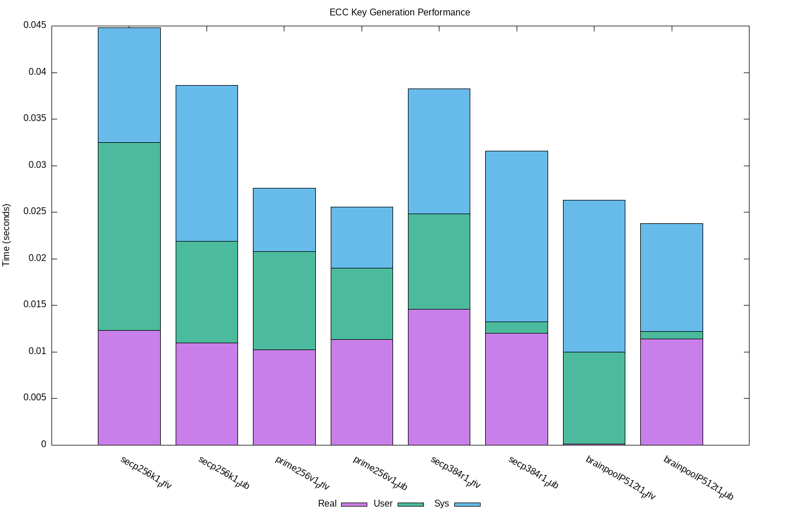
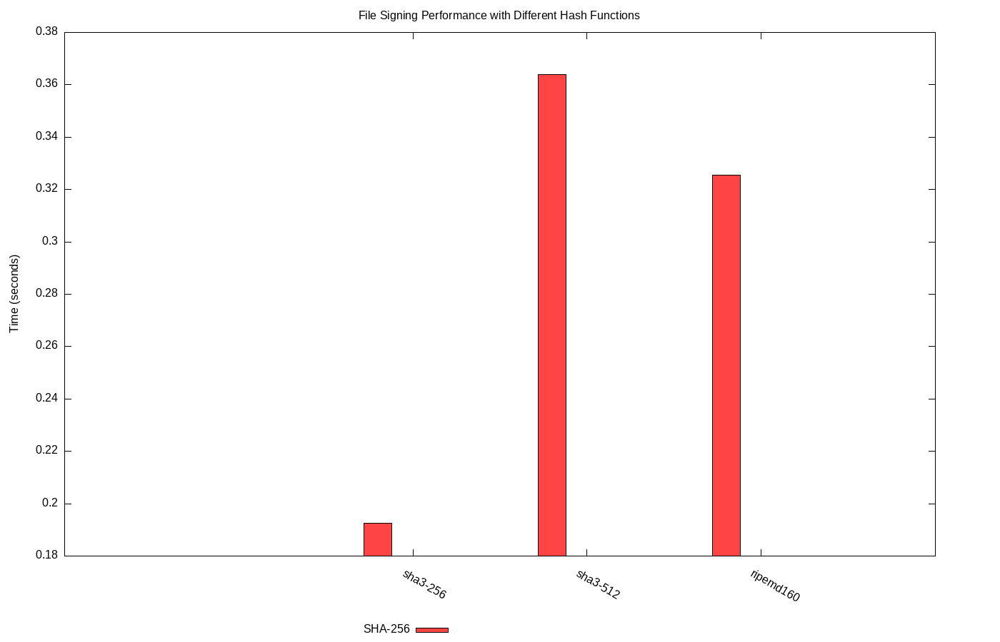

# 🔑 SPR200 — Applied Cryptography

**Hands-on cryptography: protocol diagrams, Tor onion routing, ECC benchmarks, RSA and Ed25519, zero-knowledge proofs and post-quantum signatures**

---

## 📌 Overview

Coursework from **SPR200 (Winter 2025, Seneca Polytechnic)**. These labs cover cryptography from theory to practice: diagramming protocols, watching a real key exchange on the wire, benchmarking algorithms, writing encryption and signing code, demonstrating a zero-knowledge proof, and trying post-quantum signatures.

## 🔬 Labs

| # | Lab | What I did | Files |
|---|---|---|---|
| 02 | **Describing cryptographic protocols** | Typeset protocol diagrams and flowcharts with LaTeX and TikZ | [`lab02.tex`](lab02-protocol-diagrams/lab02.tex) |
| 03 | **Key exchange in practice: Tor** | Built Tor from source, explained the 3-hop onion circuit (entry guard, middle relay, exit), and captured the TLS key exchange with Wireshark | [Report](lab03-tor-key-exchange/README.md) · [captures](lab03-tor-key-exchange/captures/) |
| 04 | **ECC and signing performance** | Bash and OpenSSL benchmarks averaged over 100 runs, plotted with gnuplot | [Results](lab04-ecc-performance/README.md) |
| 05 | **RSA and Ed25519 in Python** | RSA-2048 key generation with an encrypted private key, file encryption and decryption, Ed25519 signing and verification | [Code](lab05-rsa-ed25519/README.md) |
| 06 | **Zero-knowledge proof** | An interactive, animated terminal demo of **Schnorr's identification protocol** (Alice proves she knows *x* without revealing it) | [`schnorr_zkp_demo.py`](lab06-zero-knowledge-proof/schnorr_zkp_demo.py) |
| 07 | **Post-quantum signatures** | Key generation, signing and verification with **SPHINCS+** (SHAKE-128f) | [`sphincs_test.py`](lab07-post-quantum-sphincs/sphincs_test.py) |

## 📊 Highlight: ECC benchmarks

| ECC key generation (average of 100 runs) | Signing a 100 MB file: SHA3-256 vs SHA3-512 vs RIPEMD-160 |
|---|---|
|  |  |

## 🔐 Security notes

- No private keys are committed. `.pem`, `.key` and `.sig` files are git-ignored, and every script generates fresh keys locally.
- The RSA scripts **prompt for a passphrase** at runtime instead of hard-coding one.

## 🧰 Tools and skills

`Python (cryptography, pyspx)` · `OpenSSL` · `Bash` · `gnuplot` · `Wireshark` · `Tor` · `LaTeX / TikZ` · `Public-key cryptography` · `Digital signatures` · `Zero-knowledge proofs` · `Post-quantum cryptography`

---

Author: <b>Rabbi Muhammad Aman</b> · Academic coursework.
