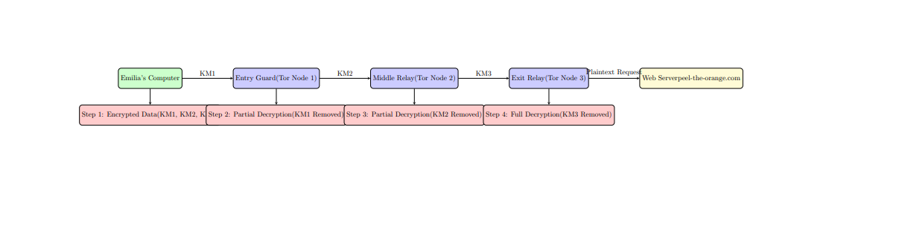

# Lab 3 — Key Exchange in Practice: The Tor Network

**Author:** Rabbi Muhammad Aman · **Course:** SPR200 (Winter 2025)

**Results**

**Part 1: How tor works**

**Below is the LaTex+Tikz generated diagram –**

**Explanation-**

**This diagram illustrates how the Tor (The Onion Router) network works to ensure privacy and**

**anonymity online. Tor achieves this by routing internet traffic through a network of volunteer-**

**run nodes that encrypt data in multiple layers. The key concept is that each node only knows**

**its immediate predecessor and successor but not the entire route or the original sender’s**

**identity. Let’s break down the process in detail:**

**1. Emilia’s Computer (Client)**

The process begins at Emilia’s computer. When she wants to visit a website (e.g., peel-the-orange.com), her request is encrypted in multiple layers using different keys: KM1, KM2, and KM3.

- KM1 is for the **Entry Guard**.

- KM2 is for the **Middle Relay**.

- KM3 is for the **Exit Relay**.

Each layer of encryption is like a layer of an onion—hence the name **Onion Routing**.

**2. Entry Guard (Tor Node 1)**

The first node in the Tor circuit is the **Entry Guard**, which knows Emilia’s IP address but does not know the final destination of her request. This node peels off the outermost encryption layer (KM1), revealing the next node's address but leaving the inner layers (KM2 and KM3) intact.

- The Entry Guard forwards the partially decrypted data to the Middle Relay.

**3. Middle Relay (Tor Node 2)**

The second node in the Tor circuit is the **Middle Relay**. This node peels off the second layer of encryption (KM2), revealing the address of the Exit Relay. The Middle Relay has no knowledge of either Emilia’s IP address or the final destination.

- It forwards the now partially decrypted data to the Exit Relay.

**4. Exit Relay (Tor Node 3)**

The third node is the **Exit Relay**. This node peels off the final layer of encryption (KM3), revealing the original request in plaintext. It then sends the plaintext request to the destination web server (peel-the-orange.com).

- Although the Exit Relay knows the final destination, it has no way of identifying Emilia’s IP address or the route taken to reach it.

#### **5. Web Server**

The web server receives the plaintext request and sends the requested information (e.g., the webpage) back through the Tor network, following the same circuit in reverse. The data is re-encrypted at each step and only fully decrypted at Emilia’s computer.

**Table: Node Knowledge**

The table summarizes what each component of the Tor circuit knows at different stages:

<table style="width:99%;">
<colgroup>
<col style="width: 99%" />
</colgroup>
<thead>
<tr>
<th><table style="width:98%;">
<colgroup>
<col style="width: 14%" />
<col style="width: 21%" />
<col style="width: 22%" />
<col style="width: 18%" />
<col style="width: 20%" />
</colgroup>
<thead>
<tr>
<th><strong>Node</strong></th>
<th><strong>Knows Entry Guard</strong></th>
<th><strong>Knows Middle Relay</strong></th>
<th><strong>Knows Exit Relay</strong></th>
<th><strong>Knows Web Server</strong></th>
</tr>
</thead>
<tbody>
<tr>
<td><strong>Emilia</strong></td>
<td>Yes</td>
<td>No</td>
<td>No</td>
<td>No</td>
</tr>
<tr>
<td><strong>Entry Guard</strong></td>
<td>Self</td>
<td>Yes</td>
<td>No</td>
<td>No</td>
</tr>
<tr>
<td><strong>Middle Relay</strong></td>
<td>No</td>
<td>Self</td>
<td>Yes</td>
<td>No</td>
</tr>
<tr>
<td><strong>Exit Relay</strong></td>
<td>No</td>
<td>No</td>
<td>Self</td>
<td>Yes</td>
</tr>
<tr>
<td><strong>Web Server</strong></td>
<td>No</td>
<td>No</td>
<td>No</td>
<td>Self</td>
</tr>
</tbody>
</table></th>
</tr>
</thead>
<tbody>
</tbody>
</table>

**Part 2: Summary of submitted log files from previous sections**

1.  **autogen.log**\
    **Description**:\
    This log file captures the output of running the ./autogen.sh command to prepare the build environment for compiling Tor. It includes checks for required dependencies and system configurations.\
    **How it was obtained**:\
    The log was generated by redirecting the command output:

./autogen.sh \> autogen.log 2\>&1

2.  **configure.log**\
    **Description**:\
    Contains the output of the ./configure command, which checks for system compatibility and prepares the Tor build configuration. It verifies the presence of necessary libraries and sets up the makefile.\
    **How it was obtained**:\
    The log was created by redirecting the command output:

./configure \> configure.log 2\>&1

3.  **make.log**\
    **Description**:\
    This log records the process of compiling Tor using the make command. It includes details about compilation steps and any errors or warnings encountered.\
    **How it was obtained**:\
    The log was created by running:

make \> make.log 2\>&1

4.  **make_install.log**\
    **Description**:\
    This log captures the output of the make install command, which installs the compiled Tor binaries on the system.\
    **How it was obtained**:\
    The log was generated by redirecting the installation process output:

sudo make install \> make_install.log 2\>&1

5.  **tor.log**\
    **Description**:\
    This log contains the runtime output of the Tor service, including messages about its connection process, circuit establishment, and any errors encountered while running Tor.\
    **How it was obtained**:\
    The log was generated by starting the Tor service with logging enabled:

tor \> tor.log 2\>&1

6.  **wiresharkcapture_tor_connection.log**\
    **Description**:\
    A Wireshark log capturing network traffic during the Tor connection process. It shows encrypted traffic between the client and Tor relays.\
    **How it was obtained**:\
    Wireshark was used to capture packets while initiating a Tor connection. The captured packets were saved as a log file.

<!-- -->

7.  **wiresharkcapture_tor_keyexchange.log**\
    **Description**:\
    This log contains Wireshark traffic capturing the key exchange process during the establishment of the Tor circuit. It highlights the Diffie-Hellman key exchange and encrypted handshake with Tor nodes.\
    **How it was obtained**:\
    Wireshark was run to capture packets during the initial key exchange when connecting to the Tor network.

<!-- -->

8.  **wiresharkcapture_tor_browser_connection.log**\
    **Description**:\
    A Wireshark log that captures traffic from the Tor Browser connecting to a website. It contains the encrypted communication between the Tor Browser and the web server through the Tor network.\
    **How it was obtained**:\
    Wireshark was used to capture packets while browsing a website with the Tor Browser.
